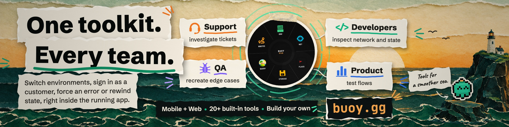
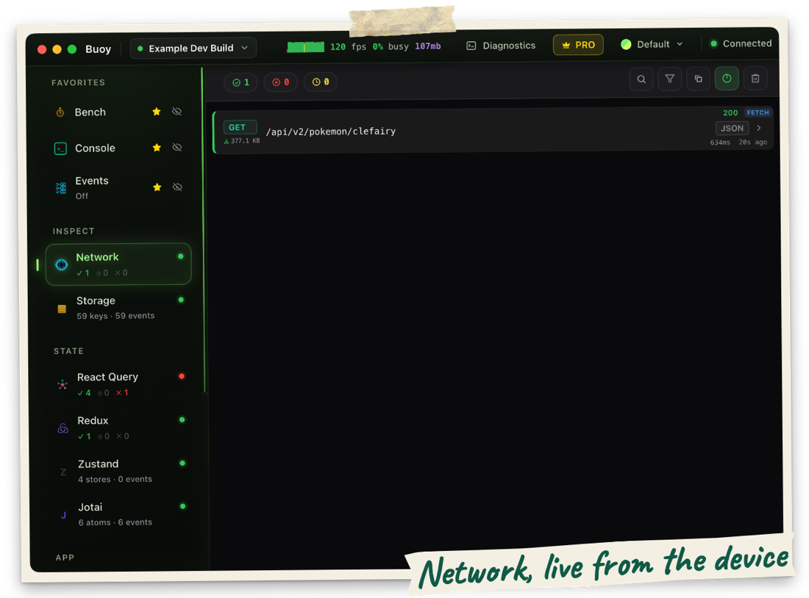

### Buoy Desktop: your app's devtools, on your computer.

<a href="https://github.com/Buoy-gg/Buoy-Desktop/releases/latest"><b>Download</b></a> &nbsp;·&nbsp; <a href="https://buoy.gg/buoy/latest/docs/desktop">Desktop guide</a> &nbsp;·&nbsp; <a href="https://buoy.gg">buoy.gg</a> &nbsp;·&nbsp; <a href="https://buoy.gg/pricing">Pricing</a>

 

 

Buoy Desktop shows the [Buoy devtools](https://github.com/Buoy-gg/buoy) running inside your React Native app, and your [Flutter app](https://github.com/Buoy-gg/Buoy-Flutter) in beta, as panels on your computer. It's the same live session as the floating menu on the phone, and you can act on the app from here: edit storage, refetch queries, navigate, and switch between connected devices.

  

## Three.js (Beta)

Scene shows the tree of your 3D app.
Pick a node to hide, move, turn, or tint it.
Use the [three.js guide](https://buoy.gg/buoy/latest/docs/web/three) for setup.
It covers R3F and plain apps with `mountBuoy`.
Add Scene and the `/web` external-sync module.
A live Desktop check is still open for this beta.

## Get started

1. [Download the latest release](https://github.com/Buoy-gg/Buoy-Desktop/releases/latest), open it, and sign in to your Free or Pro Buoy account.
2. Add `@buoy-gg/external-sync` to your React Native app (the [Quick start](https://buoy.gg/buoy/latest/docs/quick-start) covers the rest of the setup), then restart Metro and open the app.
3. Pick the device in Desktop and trigger a request in your app to check that it shows up.

Desktop sign-in and the device's key are separate. Physical devices, Android over USB, Expo tunnels and Flutter all need a little extra connection setup; the [Desktop guide](https://buoy.gg/buoy/latest/docs/desktop) covers each one, along with troubleshooting.

## What's inside

Panels for Network, Storage, Events, Console, Images, Assets, Sentry, React Query, Redux, Zustand, Jotai, Time Machine, Routes, Env, Impersonate, Renders, Bench, JS Top, Ask Buoy, Bug Links, TV Remote and Focus Inspector. There's also a live performance HUD, a simulator screenshot tool, [Camera](https://buoy.gg/buoy/latest/docs/tools/camera) for the iOS Simulator, and a diagnostics console for connection problems. The **Sims** panel shows your AI agent at work on the [Sim Farm](https://buoy.gg/buoy/latest/docs/tools/sim-farm). You see each run, with a live picture of every iOS sim and Android phone.

Which panels you see depends on the connected app, the tools it has installed, the platform and your plan. See [pricing](https://buoy.gg/pricing) for what each plan includes.

## Feedback

Found a bug, or want a panel that doesn't exist yet? [Open an issue](https://github.com/Buoy-gg/Buoy-Desktop/issues). Feature requests shape what gets built next.

## License

Proprietary software. © Buoy LLC. All rights reserved. See the [Terms of Service](https://buoy.gg/terms).

Looking for the old open-source React Query desktop tool that used to live here? Buoy Desktop replaced it and supports the full Buoy toolset.

### Native Profiler

Trace native CPU work on iOS Simulator or Android. Find hot threads and long UI work in MCP or Desktop. Needs a Buoy Pro app. [Read the guide](https://buoy.gg/buoy/latest/docs/tools/native-profiler).
